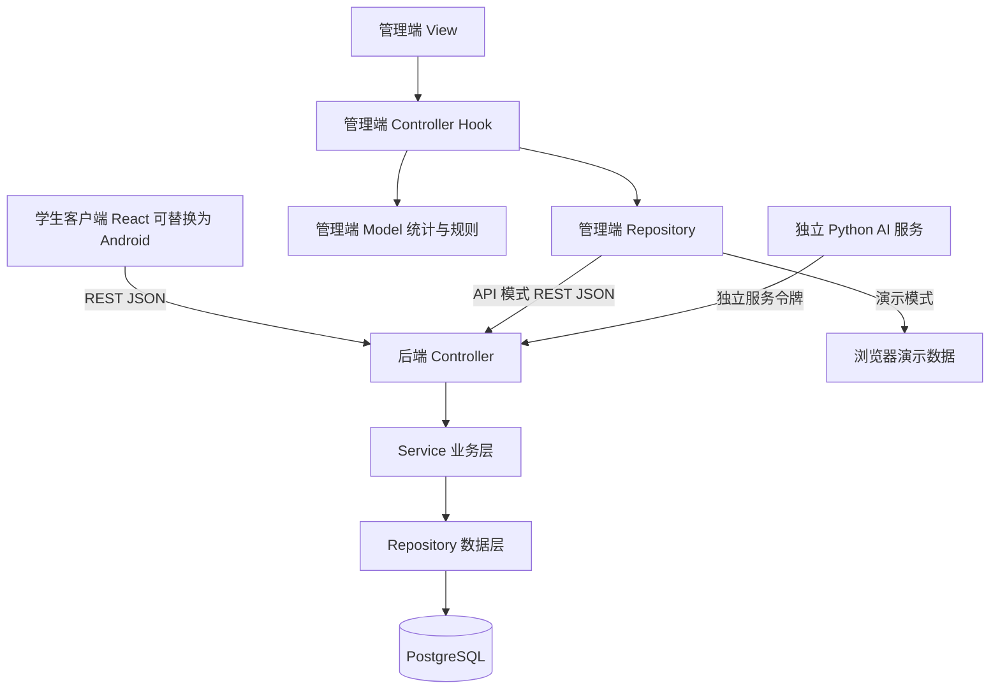

# 总体架构与修改版 MVC

项目采用 npm workspaces 单仓库、独立 Python 服务与关系型数据库。

管理端 `views` 负责展示，`controllers` 负责加载、状态与交互编排，`models` 负责领域类型使用、统计与导出规则，`repositories` 隔离演示和 API 数据源。后端控制器不直接访问数据库，按服务、仓储分层；健康检查、账号认证、教师审批和课堂管理已走完整分层，记录及统计等业务仍待实现。写操作与审计使用显式事务，会话依赖 PostgreSQL 持久化和实时角色检查。

共享情绪枚举和前端类型位于 `packages/contracts`；后端 Pydantic 模型与 Swagger 提供接口扩展点。字段采用 JSON 小驼峰，数据库使用蛇形命名，时间戳要求携带时区。前端演示编号为可读字符串，正式接口使用 UUID，切换 API 时不能发送演示编号。

系统要求包括密码加盐哈希、真实身份校验与 RBAC、教师所授课堂限制、学生个人记录范围、服务令牌隔离、CSV 注入防护、参数校验和 AI 匿名化。正式后端已实现 Argon2id 密码哈希、持久化会话、角色门禁、教师审批和课堂范围过滤。课堂独立保存实际任课教师，课程默认教师变更不转移历史课堂；学生响应只包含本人的名单信息。记录和统计业务尚未完成，不能用 UI 演示代替验收。

AI 侧仅保留结构化情绪结果，默认不保存视频、人脸图像或生物特征；“专注”“困惑”等是初始界面枚举，模型能力与课堂心理含义之间的映射需要验证并记录局限性。

独立开发联调服务 `services/integration`，提供合成账号、角色范围、SQLite 结构化结果持久化、一次性 WebSocket 票据和 AI 控制代理。它与正式后端分别运行；前端通过同一接口适配层选择演示、联调或正式 API，不能将参考服务作为线上后端。真实模型映射七种表情，“专注”“困惑”仅保留给手动反馈。
