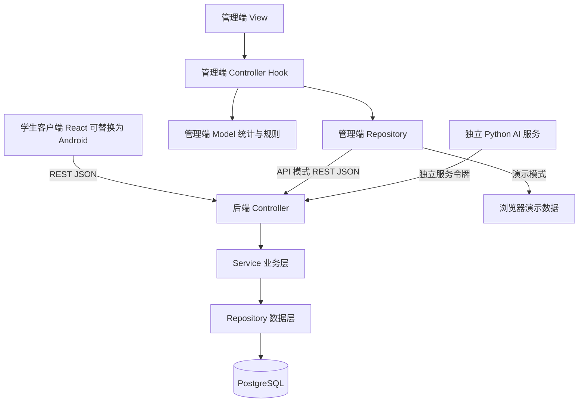

# 总体架构与修改版 MVC

项目采用 npm workspaces 单仓库、独立 Python 服务与关系型数据库。

管理端 `views` 负责展示，`controllers` 负责加载、状态与交互编排，`models` 负责领域类型使用、统计与导出规则，`repositories` 隔离演示和 API 数据源。后端控制器不直接访问数据库，账号认证、教师审批、课堂管理、手动反馈、AI 入库、历史、统计、CSV、实时授权和 AI 控制均按服务、仓储职责分层。写操作与审计使用显式事务，会话依赖 PostgreSQL 持久化和实时角色检查。

共享情绪枚举和前端类型位于 `packages/contracts`；后端 Pydantic 模型与 Swagger 提供接口扩展点。字段采用 JSON 小驼峰，数据库使用蛇形命名，时间戳要求携带时区。前端演示编号为可读字符串，正式接口使用 UUID，切换 API 时不能发送演示编号。

正式后端实现 Argon2id 密码哈希、持久化会话、角色门禁、教师审批和课堂范围过滤。课堂独立保存实际任课教师，课程默认教师变更不转移历史课堂；学生课堂响应只包含本人的名单信息。反馈和匿名 AI 记录保存稳定幂等回执；统计、趋势、分组和 CSV 读取完整授权范围，CSV 防公式注入。实时连接使用短期一次性票据，跨进程共享数据库授权与课堂版本；AI 控制只由管理员经后端固定代理调用。

AI 侧仅保留结构化情绪结果，默认不保存视频、人脸图像或生物特征；“专注”“困惑”等是初始界面枚举，模型能力与课堂心理含义之间的映射需要验证并记录局限性。

部署由 PostgreSQL、前置迁移、正式后端、独立 AI 和两个 Nginx 静态站点组成；HTTP 与 WebSocket 使用同站代理，AI 队列持久化到独立卷。生产构建与真实数据库的自动化链路见 [系统验收](system-acceptance.md)，目标环境启动、备份与恢复见 [部署说明](deployment.md)。

独立开发联调服务 `services/integration`，提供合成账号、角色范围、SQLite 结构化结果持久化、一次性 WebSocket 票据和 AI 控制代理。它与正式后端分别运行；前端通过同一接口适配层选择演示、联调或正式 API，不能将参考服务作为线上后端。真实模型映射七种表情，“专注”“困惑”仅保留给手动反馈。
